# Highly Available Web App on AWS

A load-balanced, auto-scaling web tier across two Availability Zones, defined in Terraform and tested for scaling and failure recovery.

This started as a university cloud computing assignment (CLOUD 495, Franklin University) on designing and deploying a highly available application. I used my own app idea, SafeClick, as the sample workload. The focus of this project is the architecture and how I tested it.

## Architecture

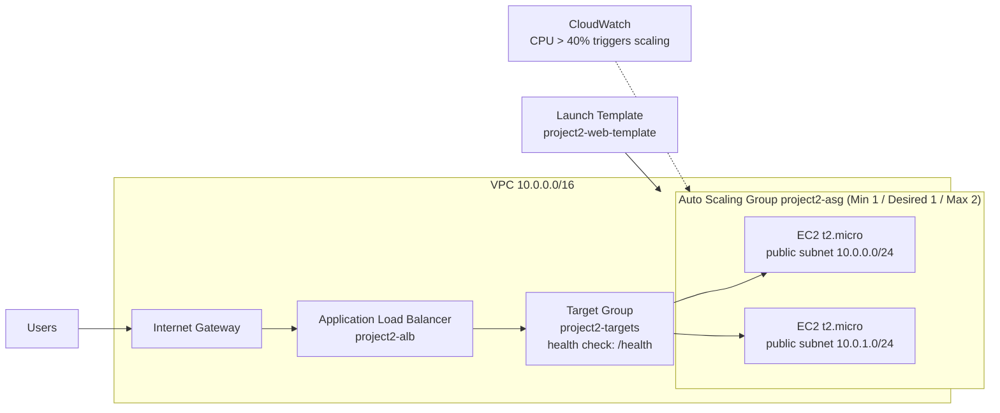

The diagram above is the Terraform design.

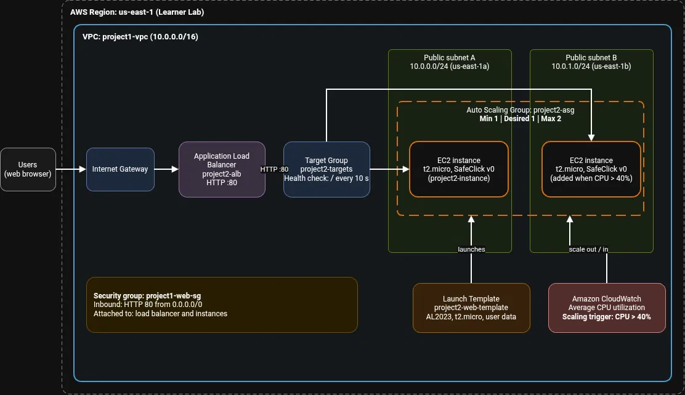

*Architecture of the tested manual deployment.*

The manual build used one shared security group and a health check on `/`. The Terraform version improves on it with separate ALB and web security groups and a dedicated `/health` endpoint.

## Components

| Component | Configuration |
|---|---|
| VPC | `10.0.0.0/16` with two public subnets (`10.0.0.0/24`, `10.0.1.0/24`) in different Availability Zones |
| Internet gateway | Attached to the VPC, with a public route table (`0.0.0.0/0`) associated with both subnets |
| Application Load Balancer | `project2-alb`, internet-facing, IPv4, HTTP:80 listener, spans both subnets, drops invalid header fields |
| Target group | `project2-targets`, HTTP:80, health check `GET /health` expecting 200 every 10s, 5s timeout, healthy and unhealthy thresholds of 2, 30s deregistration delay |
| Launch template | `project2-web-template`, latest Amazon Linux 2023 AMI (looked up from SSM), t2.micro, IMDSv2 required (hop limit 1), detailed (1-minute) monitoring, user data installs the app as a systemd service |
| Auto Scaling group | `project2-asg`, min 1, desired 1, max 2, across both subnets, ELB health checks, 300s grace period, group metrics enabled |
| Scaling policy | Target tracking on `ASGAverageCPUUtilization` at 40% |
| CloudWatch | 1-minute instance CPU metrics and the alarms the target tracking policy creates to drive scaling |

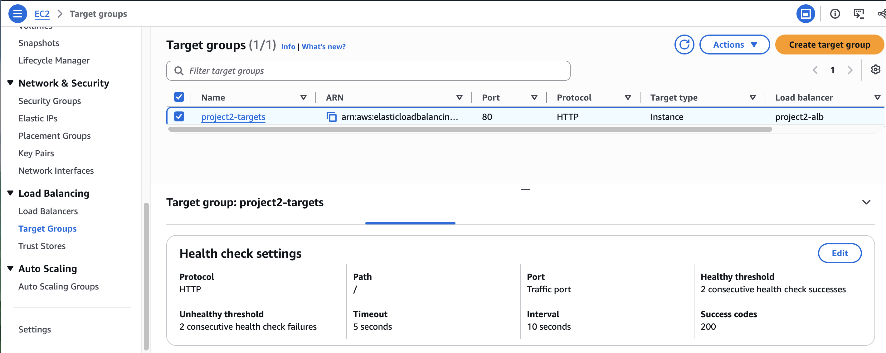

*Target group health check settings from the manual deployment.*

<details>
<summary>Screenshots of the manual console deployment</summary>

VPC, subnets, internet gateway, and route table created:
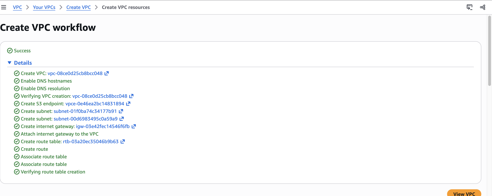

Web security group:
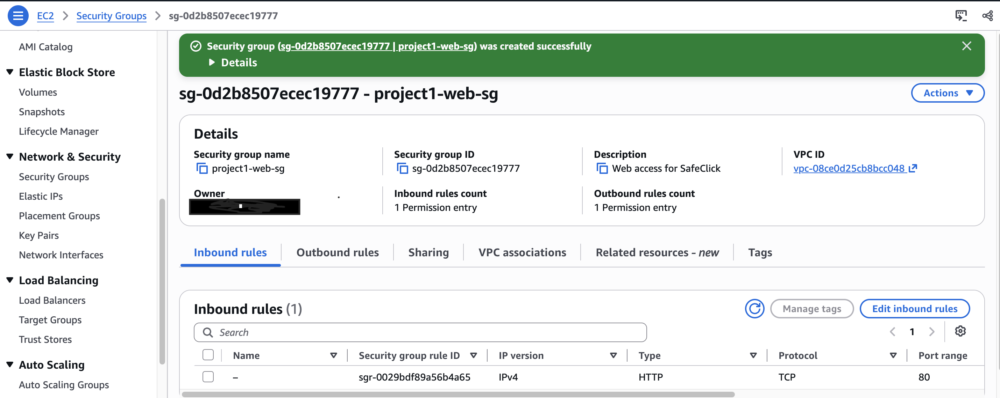

Launch template:
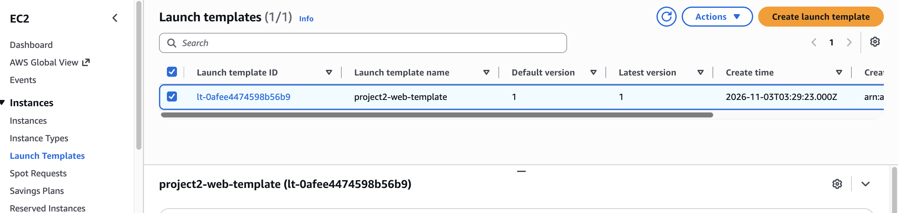

Load balancer active:
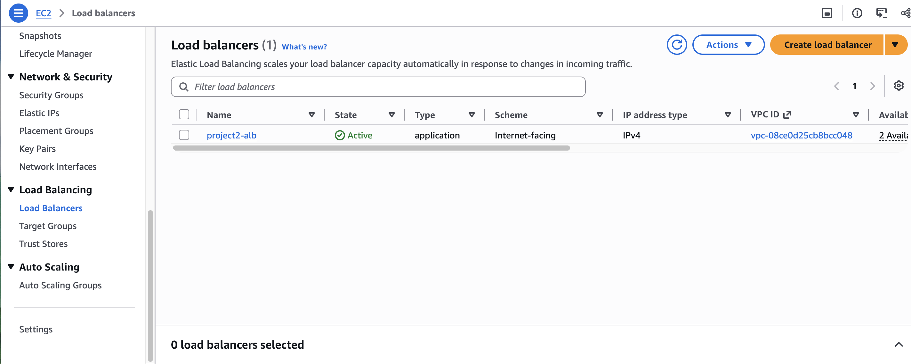

Auto Scaling group at desired capacity:
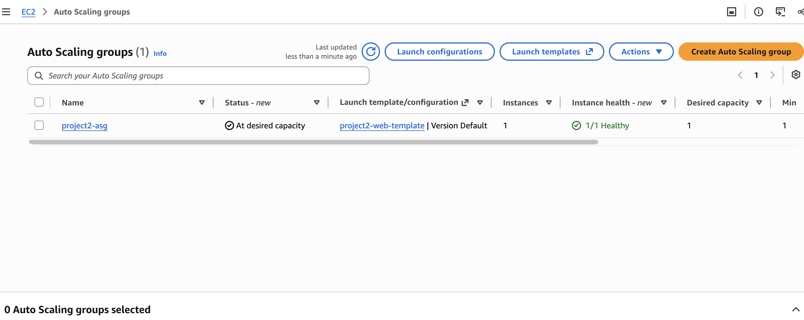

One running instance:
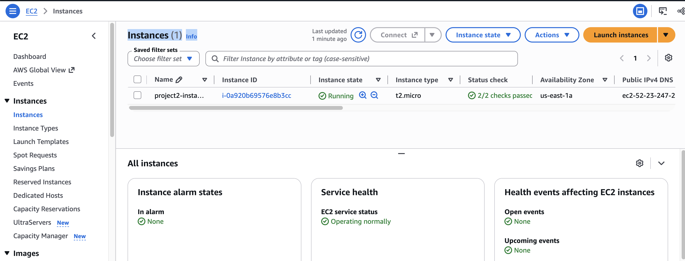

</details>

## How it stays available

- **No single critical instance.** Every instance is identical and built from the same launch template, so any one of them can be lost and replaced.
- **The ALB routes only to healthy targets.** It checks `/health` every 10 seconds and stops sending traffic to an instance after two failed checks.
- **Unhealthy instances are replaced automatically.** The Auto Scaling group uses ELB health checks, so an instance that fails the load balancer's check is terminated and replaced, not just taken out of rotation.
- **Multi-AZ placement.** The load balancer and the Auto Scaling group span two Availability Zones, so the tier can keep serving if one zone has a problem.
- **CPU-based scaling.** The target tracking policy adds an instance when average CPU goes above 40% and removes it when load drops.
- **Self-restarting instances.** The app runs under systemd with `Restart=always`, so if the process crashes it restarts in about 2 seconds without needing a new instance.

## What I tested

These tests used an earlier browser-only version of SafeClick, deployed manually through the AWS console in AWS Academy Learner Lab. This repo contains the improved app and a Terraform template of the same architecture, which I have not applied.

**Load distribution.** I sent repeated `curl` requests to the ALB DNS name. The Instance ID on the page alternated between instances.

```bash
for i in {1..10}; do curl -s http://<ALB-DNS> | grep "Instance ID"; sleep 1; done
```

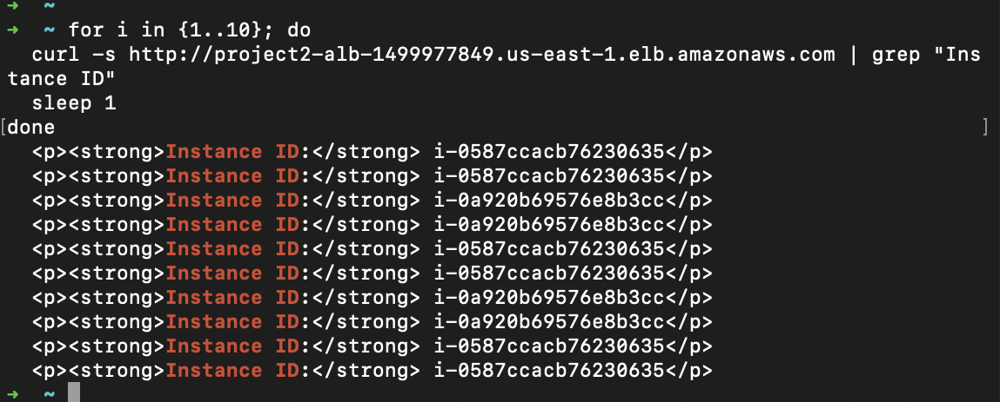

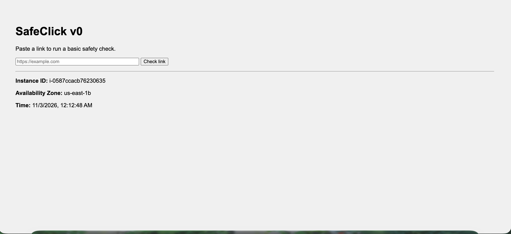

*The page served from the second Availability Zone.*

**Scale-out.** I started a CPU stress process at 11:53 PM. The Auto Scaling group had two instances running by 12:07 AM. I stopped the stress process at 12:17 AM, after which the group scaled back in. CPU peaked at about 99.65%.

```bash
yes > /dev/null & yes > /dev/null & yes > /dev/null &
killall yes
```

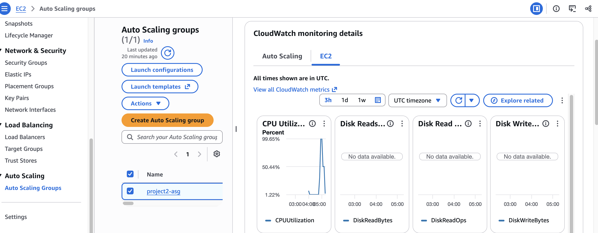
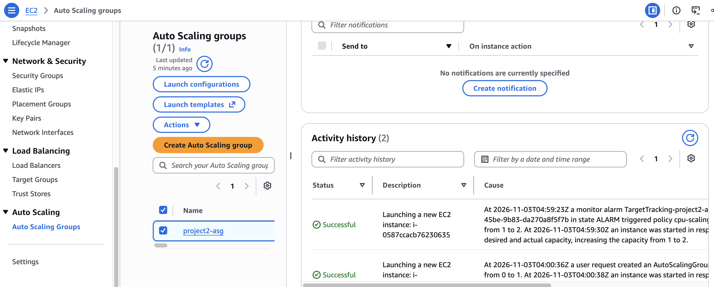
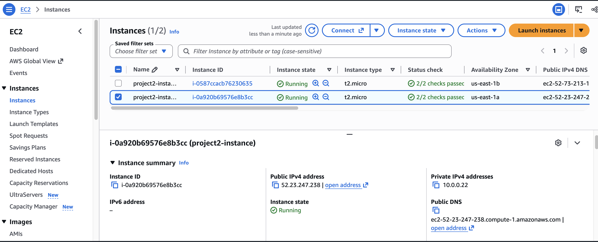

**Failure recovery.** I terminated a running instance and the Auto Scaling group launched a replacement at 12:18 AM. During the termination, one request returned a 504 at 12:19:04 AM, then all requests returned 200 again. Requests in flight to an instance as it shuts down can fail; in production I would tune the deregistration delay and rely on connection draining to reduce this.

```bash
while true; do
  echo "$(date '+%H:%M:%S') - Status: $(curl -s -o /dev/null -w '%{http_code}' http://<ALB-DNS>/health)"
  sleep 1
done
```

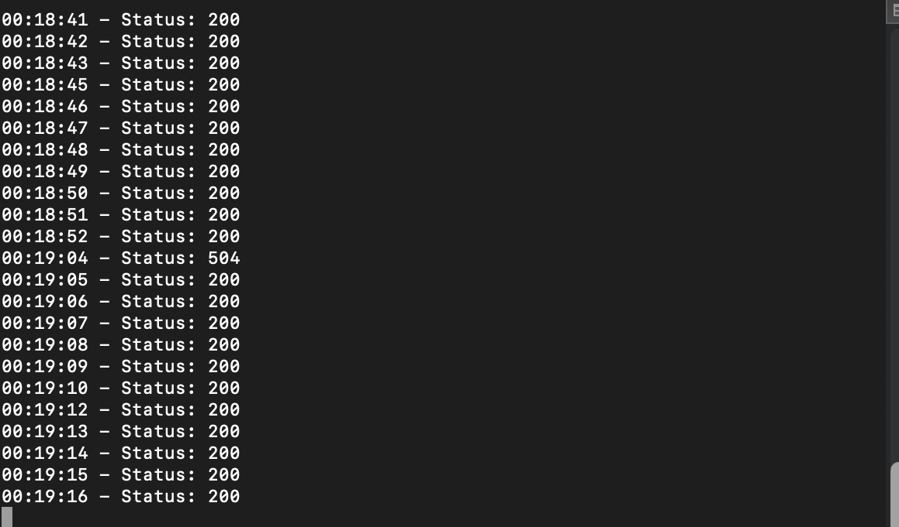
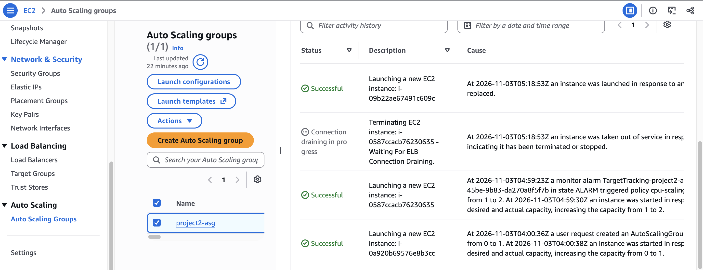

## Infrastructure as code

[`infra/main.tf`](infra/main.tf) builds the whole environment above: the VPC, subnets, internet gateway and route table, two security groups, the launch template, target group, load balancer and listener, the Auto Scaling group, and the CPU scaling policy.

**Security group design.** I used two security groups instead of one shared group. The internet can reach only the load balancer on port 80. The web instances accept port 80 only from the ALB security group, and SSH only from a single IP set in `ssh_cidr`.

**Hardening and availability features:**
- **Dedicated `/health` endpoint.** The health check returns a fixed response and never depends on an outside website, so a slow third-party site can't make an instance look unhealthy.
- **IMDSv2 required.** The launch template requires session tokens for instance metadata.
- **Sandboxed systemd service.** The app runs as a throwaway user (`DynamicUser=yes`) with `NoNewPrivileges=yes` and only the capability to bind port 80.
- **Self-contained user data.** [`scripts/build_user_data.py`](scripts/build_user_data.py) compresses the app into [`infra/user-data.sh`](infra/user-data.sh) (under the 16 KB EC2 limit), so new instances boot with nothing to download or install.

**CI.** [`.github/workflows/ci.yml`](.github/workflows/ci.yml) runs on every push to `main` and on pull requests. It runs the unit tests, rebuilds the user data and fails if `user-data.sh` is stale, and runs `terraform fmt`, `init`, and `validate`.

To deploy with Terraform:

```bash
cd infra
cp terraform.tfvars.example terraform.tfvars   # set ssh_cidr to your IP/32
terraform init
terraform plan
terraform apply
```

| Path | Contents |
|---|---|
| `infra/` | Terraform for the full environment |
| `infra/user-data.sh` | Generated bootstrap script for the launch template |
| `scripts/build_user_data.py` | Packs the app into the user data script |
| `app/safeclick.py` | The sample workload (Python standard library only) |
| `tests/` | Unit tests (SSRF blocking, routes, user data) |
| `docs/` | Screenshot checklist |

## Issues I ran into

- The target group could not be deleted while the ALB listener still used it, so I deleted in order: Auto Scaling group, then load balancer, then target group.
- The EC2 Instances page looked empty after the Auto Scaling group was created. I confirmed the launch in the ASG Activity tab and then found the instance.
- Learner Lab does not allow creating IAM roles, so I used the precreated `LabInstanceProfile`.

## Known limitations and production changes

| Current state | What I would do in production |
|---|---|
| HTTP only | HTTPS with an ACM certificate on the ALB |
| Instances in public subnets | Private subnets with a NAT gateway, only the ALB public |
| No `instance_refresh`, so launch template changes don't reach running instances | Add an `instance_refresh` block to the Auto Scaling group |
| No rate limit or concurrency cap on `/api/scan` | Rate limiting in the app, or a WAF rate-based rule on the ALB |
| The `ssh_cidr` validation only rejects the exact string `0.0.0.0/0` | Stricter validation that requires a /32, or remove SSH and use Session Manager |

## About the sample app

SafeClick checks a site's HTTPS certificate and security headers and returns a green, yellow, or red verdict with reasons. Each page shows the Instance ID and Availability Zone that served it, which made load balancing visible during testing. The scanner blocks requests to private and internal addresses, including the EC2 metadata service, to prevent SSRF.

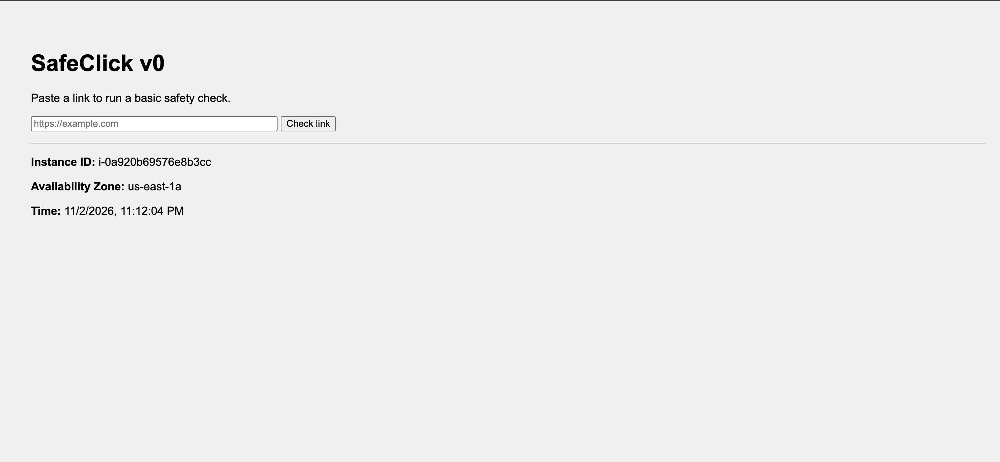

## Learner Lab notes

- Instances use the built-in `LabInstanceProfile` and the `vockey` key pair (download `labsuser.pem` from AWS Details).
- The load balancer keeps using the lab budget after the session ends, so clean up when finished.

## Cleanup

- Terraform: `terraform destroy`
- Console: delete the Auto Scaling group first (otherwise it launches replacements), then the load balancer, then the target group.

## Run locally

```bash
PORT=8080 python3 app/safeclick.py   # open http://localhost:8080
python3 -m unittest discover tests -v
```
