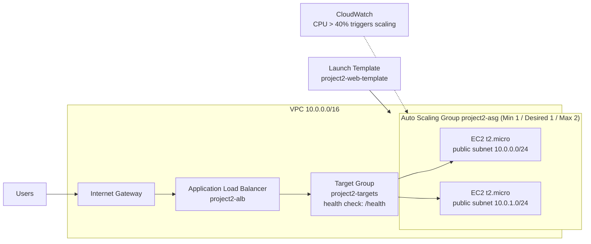

# SafeClick

**Check a link before you trust it.** SafeClick is a website safety checker: enter a URL and it reports whether the site's HTTPS certificate is trusted and which browser security protections it uses, explained in plain language.

This version (v0) runs as a highly available, auto-scaling web service on AWS behind an Application Load Balancer. It was built for CLOUD 495 Mini-Project 2 (Launch, Scale, and Recover a Compute Service) at Franklin University, using SafeClick in place of the sample demo page.


## What it checks

| Check | What it tells you |
|---|---|
| TLS certificate | Whether the certificate is trusted, who issued it, when it expires, and the TLS version |
| Security headers | HSTS, Content Security Policy, X-Frame-Options, X-Content-Type-Options, Referrer-Policy, Permissions-Policy |
| Verdict | Green (well configured), yellow (use caution), or red (risky) |

Every page also shows the **Instance ID** and **Availability Zone** that served it, which makes load balancing and failover visible.

## Architecture



| Component | Configuration |
|---|---|
| Launch template | Amazon Linux 2023, t2.micro, IMDSv2 required, user data installs SafeClick as a systemd service |
| Target group | HTTP:80, health check `/health` every 10s, healthy/unhealthy threshold 2, timeout 5s |
| Load balancer | Internet-facing ALB, HTTP:80 listener, spans two Availability Zones |
| Auto Scaling | Min 1, desired 1, max 2, ELB health checks, 300s grace period |
| Scaling policy | Target tracking on average CPU at 40% |

## Repository layout

```
app/safeclick.py              The app (Python standard library only)
scripts/build_user_data.py    Packs the app into the EC2 user data script
infra/                        Terraform for the full environment
infra/user-data.sh            Generated bootstrap script for the launch template
tests/                        Unit tests (SSRF blocking, routes, user data)
.github/workflows/ci.yml      Tests plus terraform fmt and validate on every push
docs/                         Screenshots and diagram
```

## Run it locally

```bash
PORT=8080 python3 app/safeclick.py
# open http://localhost:8080
python3 -m unittest discover tests -v
```

## Deploy

### Option A: AWS Console (as in the lab)
Follow the lab steps, with these changes:
- **User data:** paste the contents of `infra/user-data.sh`.
- **Health check path:** `/health` instead of `/`.

### Option B: Terraform

```bash
cd infra
cp terraform.tfvars.example terraform.tfvars   # set ssh_cidr to your IP/32
terraform init
terraform plan
terraform apply
```

Open the `alb_dns_name` output in a browser. Instances need about 3 to 5 minutes to pass health checks.

## Testing scaling and recovery

**Load distribution**
```bash
for i in {1..10}; do curl -s http://<ALB-DNS> | grep "Instance ID"; sleep 1; done
```

**Scale out:** SSH to the instance and generate CPU load, then watch CloudWatch and the Auto Scaling activity tab.
```bash
ssh -i labsuser.pem ec2-user@<INSTANCE-PUBLIC-IP>
yes > /dev/null & yes > /dev/null & yes > /dev/null &
killall yes   # when the second instance is healthy
```

**Failure recovery:** run this, then terminate one instance in the EC2 console.
```bash
while true; do
  echo "$(date '+%H:%M:%S') - Status: $(curl -s -o /dev/null -w '%{http_code}' http://<ALB-DNS>/health)"
  sleep 1
done
```

## Design decisions

- **No dependencies.** The app uses only the Python standard library, so new instances boot without installing packages. Faster boot means Auto Scaling replacements become healthy sooner.
- **Self-contained user data.** The app is compressed into the user data script, staying under the 16 KB EC2 limit with no `git clone` or internet dependency at boot.
- **Dedicated `/health` endpoint.** The health check never depends on an outside website, so a slow third-party site can't mark an instance unhealthy.
- **SSRF protection.** A tool that fetches user-supplied URLs could be pointed at internal addresses, including the EC2 metadata service at 169.254.169.254. SafeClick rejects private, loopback, link-local, and other non-public addresses, allows only ports 80 and 443, and connects to the exact IP it validated to prevent DNS rebinding.
- **IMDSv2 required.** The launch template requires session tokens for instance metadata.
- **Least-privilege networking.** The internet reaches only the load balancer. Instances accept HTTP only from the load balancer's security group and SSH only from one IP.
- **Unprivileged service.** systemd runs the app as a throwaway user with only the capability to bind port 80.
- **Practices what it checks.** SafeClick's own responses send CSP, X-Frame-Options, and other security headers.

## AWS Academy Learner Lab notes

- Learner Lab doesn't allow creating IAM roles, so instances use the built-in `LabInstanceProfile`.
- The key pair is the built-in `vockey` (download `labsuser.pem` from AWS Details).
- An Application Load Balancer needs subnets in at least two Availability Zones, so the VPC has two public subnets.
- Lab sessions end after a few hours, but the load balancer keeps using the lab budget. Clean up when finished.

## Issues I ran into

<!-- Fill in after deploying: what broke, how you diagnosed it, and the fix. -->

## Cleanup

Terraform: `terraform destroy`

Console: delete the Auto Scaling group first (otherwise it launches replacements), then the load balancer, then the target group.

## Roadmap

- AI assistant that explains results and answers follow-up questions
- Domain age and phishing blocklist checks
- Scan history
- File checker (hash lookup against malware databases)
- HTTPS on the load balancer with an ACM certificate
